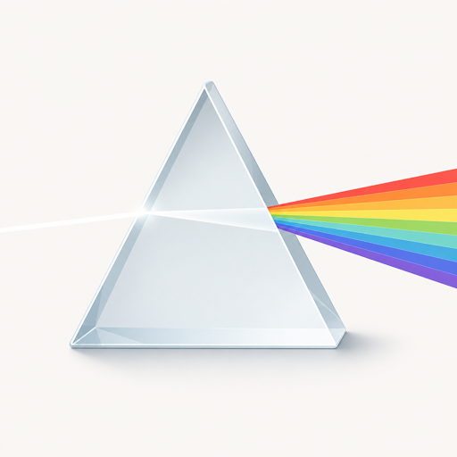
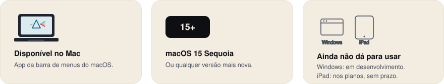
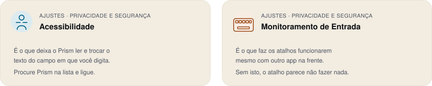
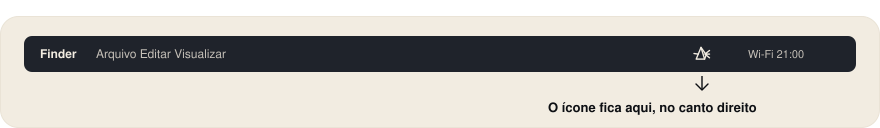
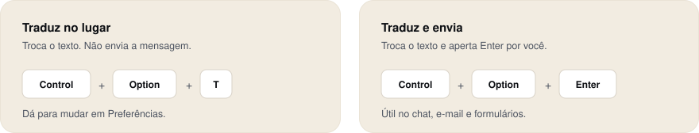

<p align="center">
  
</p>

<h1 align="center">Prism Translate</h1>

<p align="center">
  Traduz o texto do campo em que você está digitando.<br>
  Fica na barra de menus do Mac — rápido, quase sem janela.
</p>

<p align="center">
  Edição Community · uso pessoal e estudo. O uso comercial requer licença específica.
</p>

<p align="center">
  
</p>

## Instalar

A forma mais simples é pelo **Homebrew**. Cole estes três comandos no Terminal:

```bash
brew tap goobinexe/tap
brew trust --tap goobinexe/tap
brew install --cask prism-translate
```

O segundo comando (`trust`) é obrigatório enquanto o Prism não estiver no catálogo oficial do Homebrew — você está dizendo que confia no repositório do autor. Apps de menu bar usam `brew install --cask` (não `brew install` sozinho).

**Primeira vez no Mac?** Siga o [tutorial de instalação](INSTALL.md) passo a passo (instalar o Homebrew, abrir o app, permissões e aviso do macOS).

**Sem Homebrew?** Baixe o `Prism-x.y.z.zip` em [GitHub Releases](../../releases), descompacte e arraste **Prism** para **Aplicativos**. Detalhes no [INSTALL.md](INSTALL.md#alternativa-sem-homebrew).

**Futuro:** quando o cask entrar no repositório oficial do Homebrew, bastará:

```bash
brew install --cask prism-translate
```

Instalador DMG assinado pela Apple (Developer ID) fica em aberto para uma versão posterior.

### Permissões

Na primeira execução o Prism pede duas permissões. Sem elas ele não lê nem troca o texto.

<p align="center">
  
</p>

**Acessibilidade** deixa o app pegar e colocar o texto. **Monitoramento de Entrada** deixa os atalhos funcionarem em qualquer programa. Os dois ficam em **Ajustes do Sistema → Privacidade e Segurança**.

Quando terminar de autorizar, o prisma aparece no canto direito do topo da tela:

<p align="center">
  
</p>

## Desinstalar

**Instalou pelo Homebrew?** No Terminal:

```bash
brew uninstall --cask prism-translate
```

Para apagar também preferências e dados locais (logs, ajustes salvos):

```bash
brew uninstall --cask --zap prism-translate
```

**Baixou o zip manualmente?** Saia do Prism (menu do prisma → **Sair**, no rodapé; **Ligado** só pausa o app), arraste **Prism** de **Aplicativos** para o Lixo e esvazie o Lixo.

**Limpar permissões (opcional):** em **Ajustes do Sistema → Privacidade e Segurança**, remova **Prism** de **Acessibilidade** e **Monitoramento de Entrada**.

Se quiser apagar tudo à mão (sem `--zap`), apague estas pastas no Finder (**Ir → Ir para a pasta…**, ⌘⇧G):

- `~/Library/Preferences/dev.prism.tradutor.plist`
- `~/Library/Application Support/Prism`

Chaves de API ficam no **Chaveiro** do Mac (serviço `dev.prism.tradutor`); remova-as lá se não for reinstalar.

Mais detalhes no [tutorial de instalação](INSTALL.md#desinstalar).

## Usar

Sem configurar nada, a tradução é a da Apple, no próprio Mac.

<p align="center">
  
</p>

Esses atalhos quase não brigam com os de outros apps. Dá para mudar — ou voltar ao padrão — em **Configurações → Atalhos**.

Em texto só de leitura, **⌃⌥T** abre o painel de tradução. **⌃⌥Y** abre o painel com **Modo popup** ligado.

No menu do prisma, de cima para baixo:

- **Ligado** pausa o Prism; não fecha o app
- Um aviso aparece quando falta permissão, com o botão **Corrigir…**
- **Texto que leio →** e **Texto que escrevo →** definem os idiomas; ao lado fica o provedor, com **Configurar…**
- **Modo popup** abre um painel com a tradução, em vez de só substituir no campo
- Em **Mais opções**: **Enter traduz e envia** (o Enter sozinho também traduz) e **Aviso perto do ponteiro** (um recado discreto na hora da tradução)
- No rodapé: **Configurações**, **Guia de configuração** (reabre o tutorial inicial) e **Sair** (fecha o app)

O **clique direito** no prisma abre um menu rápido do macOS com cinco itens: **Ligado**, **Traduzir área de transferência**, **Traduções recentes** (clique numa delas para copiar de novo), **Configurações…** e **Sair**. Quando falta permissão, **Configurações…** dá lugar a **Corrigir permissões…**.

No painel de tradução, **Copiar** copia o texto e fecha o painel (clique, ⌘C ou Enter quando o texto é só de leitura). **Substituir** (Enter) aparece quando o campo é editável. O par de idiomas no topo do painel abre um menu para traduzir para outro idioma. Esc fecha.

Depois de substituir, o aviso perto do ponteiro mostra **Desfazer** por alguns segundos.

Em **Configurações**, **Abrir no login** deixa o Prism pronto quando você entra na conta, e **Apps ignorados** desliga os atalhos em apps escolhidos, como o Terminal.

## Outras formas de traduzir

O padrão é a tradução da Apple. Se quiser outra, abra **Configurações → Provedor**:

- **DeepL** ou **Google** — você cola a chave da API
- **LM Studio** (ou qualquer servidor no estilo OpenAI) — no seu computador
- **HTTP personalizado** — se você já tem um endpoint próprio

As chaves ficam no chaveiro do Mac.

## Licença

Uso pessoal, estudo e pesquisa: ok. Empresa, produto ou qualquer uso comercial: precisa de uma licença combinada com o autor.

O texto completo está em [`LICENSE`](LICENSE) (PolyForm Noncommercial 1.0.0).

---

Quer abrir o projeto no Xcode? Clone o repositório, abra `Prism.xcodeproj` (macOS 15+, Xcode 16+) e rode o target **Prism**.
